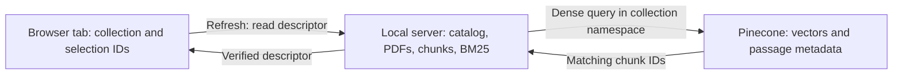
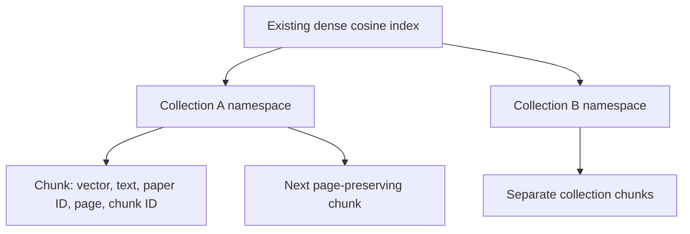

# Configure the live model and Pinecone

The optional adapter has mocked regression coverage and a bounded live integration check: one four-page public PDF, twelve chunks, namespace visibility, semantic retrieval, and a generated answer with a page citation. Human review found an omitted source exception despite audit approval; generation/audit instructions and a conservative local exclusion guard now address that failure. This is not a quality benchmark. Use an existing compatible index; this app never creates an index, changes its configuration, or deletes remote vectors.

## Enter credentials locally

1. Open `.env` in your local editor. If it does not exist, copy `.env.example` to `.env`. Do not paste keys into chat, the browser UI, GitHub, screenshots, or the project brief.
2. Fill `MODEL_API_KEY` for your chosen model provider. Set `MODEL_BASE_URL`, `CHAT_MODEL`, and `EMBEDDING_MODEL` to models/endpoints your account supports. The default live configuration is `gpt-4.1-mini` plus `text-embedding-3-small` at the OpenAI-compatible base URL in the template.
3. If embeddings use another provider, fill `EMBEDDING_API_KEY` and `EMBEDDING_BASE_URL`. Otherwise leave these blank to reuse the model provider settings.
4. Enter `PINECONE_API_KEY` and the exact existing `PINECONE_INDEX_NAME`. Use a key with access only to the intended project where practical.
5. Confirm the existing index accepts externally generated **dense** vectors with the **cosine** metric. Set `EMBEDDING_DIMENSIONS` to the actual embedding output size and index dimension; the default small embedding model normally uses 1536. Integrated-embedding and sparse indexes are not supported by this adapter.
6. Set `EVIDENCE_ATLAS_MODE=live` and `VECTOR_BACKEND=pinecone`. Keep `PINECONE_NAMESPACE_PREFIX=evidence-atlas`, or use a project-specific prefix beginning `evidence-atlas-`. Each collection gets a fresh random suffix, so the app never uses the default or an existing unrelated namespace.
7. Install the adapter if needed: `python -m pip install -r requirements-pinecone.txt`. It is already installed in this workspace and included in the recorded complete lock file.
8. Restart the server and load a small public sample first. The mode badge shows the configured backend, and the library shows the created namespace after indexing succeeds. Configuration presence does not imply a successful connection.

```dotenv
EVIDENCE_ATLAS_MODE=live
VECTOR_BACKEND=pinecone
MODEL_API_KEY=
PINECONE_API_KEY=
PINECONE_INDEX_NAME=
EMBEDDING_MODEL=text-embedding-3-small
EMBEDDING_DIMENSIONS=1536
PINECONE_NAMESPACE_PREFIX=evidence-atlas
```

The blank values above must be filled only in your ignored local `.env`. Do not commit a filled example.

## What the adapter checks

Before sending the corpus, it probes the embedding dimension using a fixed non-document string, reads the named index's description, and verifies dimension, dense-vector type, cosine metric, and ready status. It resolves the host from that description and uses the host for the data client. It then writes only into a new `evidence-atlas-<random collection id>` namespace through `PineconeVectorStore`.

Ingestion waits up to 12 seconds for the namespace's reported vector count because Pinecone is eventually consistent. A failed/partial write reports its namespace with a safe error message. No automatic remote cleanup occurs. A compatible paid model call and Pinecone operations may consume your provider credits; no new paid resource is created by the app.

Hybrid retrieval remains semantic-vector ranks plus local BM25 ranks and reciprocal rank fusion. It is not Pinecone-native sparse hybrid search or a model reranker. Dense candidates are capped at 1,000 per query for payload size; returned chunk IDs are reconciled with the current local collection before citations are displayed.

The adapter passes independent document copies to Pinecone ingestion because the vector-store library adds a transport `text` field to metadata. Local source metadata stays unchanged, and evidence construction owns its identifiers and passage text even if transport metadata contains reserved fields. This prevents a successful upload from failing during subsequent question answering.

## Persistence and clearing

Pinecone retains vectors **and passage text/metadata** after the local process stops. Original PDF bytes, the local BM25 corpus, and the collection catalog remain in server memory. The browser now stores only the active collection ID and selected document IDs in tab-scoped `sessionStorage`. A refresh reads the existing descriptor through `GET /api/collections/{id}` without embedding or upserting. A cleared or expired collection produces an explicit restoration error; it never silently substitutes another document. Transient failures retain the pointer for retry.

Remote vectors alone do not restore a usable collection after **server restart**, and this prototype does not implement a durable collection catalog. Closing a tab ends its saved selection. Refresh restoration does not preserve chat history or answer text.



The three layers have different lifetimes: the tab remembers what to open, the running backend knows how to serve it, and Pinecone retains remote vectors. Persistence of the third layer does not replace the first two.

## Index, namespace, and chunks



These are illustrative labels, not account identifiers. Each new upload or sample gets an isolated namespace. Chunk IDs reconcile remote matches with the current local corpus; citations keep original physical PDF pages.

| Configuration verified in the isolated test | Value |
|---|---|
| Vector type | Dense, externally generated embeddings |
| Dimension / metric | 1536 / cosine |
| Deployment | Serverless, AWS, us-east-1 |
| Embedding model | `text-embedding-3-small` |
| Resource lifecycle | Existing index; no automatic provisioning or remote deletion |

| Behavior | Memory backend | Pinecone backend |
|---|---|---|
| Dense vectors | Local process | Remote collection namespace |
| BM25 corpus and original PDFs | Local process | Local process |
| Same-tab refresh | Restores while server runs | Restores while server runs |
| Server restart | Local collection lost | Local collection lost; remote vectors remain |
| Live generation | Configured provider | Same configured provider |

**Clear collection clears local state only.** It deliberately does not delete Pinecone data. Keep the namespace shown by the app if you want to manage those vectors later in your Pinecone console. Reindexing creates another namespace; review unused namespaces yourself. No data in unrelated namespaces is read, overwritten, or deleted by this adapter.

To return to a credential-free local demo, set `EVIDENCE_ATLAS_MODE=demo` and `VECTOR_BACKEND=memory`, then restart. Never silently substitute local retrieval after a failed live configuration; the app surfaces the error.

## Verification boundaries

On October 18, 2026, the user reported that the updated isolated live/Pinecone browser experience worked after the citation and refresh fixes. This is a user-reported manual confirmation, not an instrumented quality measurement; exact queries and coverage were not recorded. See [VERIFICATION.md](VERIFICATION.md). Existing completeness and persistence limitations remain unchanged.

A public four-page PDF produced twelve vectors and supported a bounded ingestion/retrieval/answer check. Human review caught an omitted payer exception despite model approval. The captured omission is rejected offline; a later public live replay included the exception and passed the audit. The transport metadata collision was corrected and live submission succeeded. Browser refresh of a nine-passage upload was verified on the root page and the private test wrapper without reindexing.

Two uploaded-document questions originally failed for different reasons: unknown citation and evidence-audit rejection. A request-specific citation enum prevents selection of unprovided IDs. A subsequent bounded replay returned answers, but source review caught facts combined under one citation. The new literal-detail guard rejects those captured drafts offline. Separately cited synthetic role and skill lists passed live checks after schema clarification. A final authorized replay of the two original questions returned separately cited claims and passed the audit; individual source support was reviewed. The answers were not exhaustive lists, so completeness remains a limitation. These tests are not broad answer-quality evidence.

Mock tests cover mismatched dimensions/metrics, non-ready/sparse/integrated indexes, missing credentials, safe namespaces, isolated writes, and redacted partial-write failures. They do not prove your account permissions, network, billing, embedding-model availability, or service latency. The current 75% → 80% retrieval comparison is an offline result, not a Pinecone benchmark.

The implementation uses the official [LangChain PineconeVectorStore API](https://reference.langchain.com/python/langchain-pinecone/vectorstores/PineconeVectorStore), Pinecone's [index-targeting guidance](https://docs.pinecone.io/guides/manage-data/target-an-index), and [data-freshness guidance](https://docs.pinecone.io/guides/index-data/check-data-freshness). Installed adapter versions are recorded in `requirements-lock.txt`.
